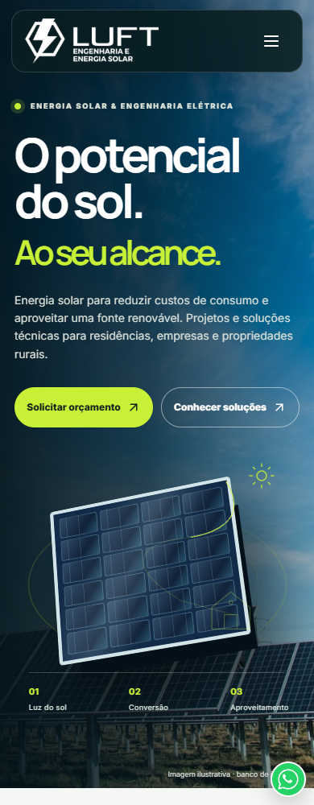
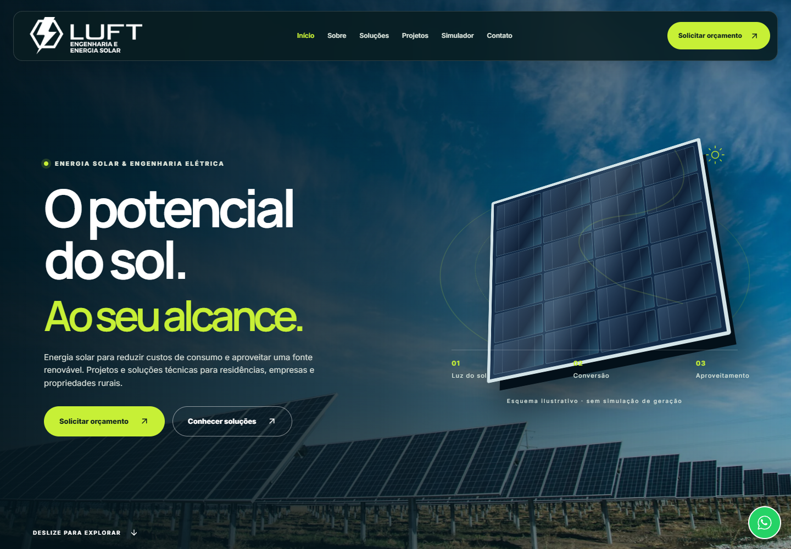

# LUFT Engenharia — Publicação e evidências

Aprovação visual informada pelo usuário na Fase 04. Direção: Engenharia explicada com precisão e contraste.

## Experiência implementada

Diagrama relaciona valor bruto, percentual considerado e economia; barra deriva do cálculo; leitura dos resultados permanece ao lado dos parâmetros em desktop.

## Estado observado

- Commit de código validado: `78f2c05e1ee8a3b5e3e7d52dae3ce1244b921715`.
- Branch de produção configurada: `main`; histórico e branch local de modernização preservados.
- URL pública testada: https://luft-engenharia-redesign.vercel.app.
- Deployment preparado: `dpl_CtFfnaFjtQsrzJ8ce6gYh5ECoqB6`.
- Smoke de produção: 6 rota(s), sem achados axe, imagens quebradas, erros HTTP da origem ou exceções de página no escopo executado.
- Reflow na primeira rota: 390, 768, 1024 e 1440 px. As quatro larguras não foram executadas em todas as rotas por esse smoke.
- Três cenários de interação: desktop normal, mobile normal e mobile com movimento reduzido; cenário de jornada composto. Testes desta fase em Chromium/Chrome. Resultados anteriores em Firefox/WebKit permanecem históricos; WebKit não equivale a Safari real.
- Métricas exploratórias sem throttling não são Core Web Vitals de campo.

## Capturas





## Execução independente

Consultar o comando do README e o script local existente. No Second Brain, também é possível usar:

```powershell
node "C:/Users/weles.AVELL_W/Documents/Second Brain/Dev/Referências/QA-Fase03/iniciar.mjs" luft
```

URL local: http://127.0.0.1:4302/simulador . Next exige dependências e build.

## Limites e pendências

Simulação simplificada, sem garantia de retorno. Fórmulas e ressalvas existentes preservadas.

Safari real, dispositivos físicos, leitores de tela, métricas reais de usuários e direitos/licenças de ativos permanecem pendentes. Os testes não certificam conformidade completa ou operação comercial real.

## Rollback

Conferir o commit anterior e o deployment anterior READY no relatório consolidado da Fase 04. Usar rollback apenas no projeto/equipe conferidos e validar novamente a URL. Reverter código com commit, sem force push. Não há garantia de rollback instantâneo onde não existia produção anterior READY.

Fonte: pedido do usuário, código e ensaios registrados em 26/11/2026; síntese do Codex. Evidências completas, vídeos e tentativas anteriores permanecem no Second Brain, no painel local da Fase 04.
